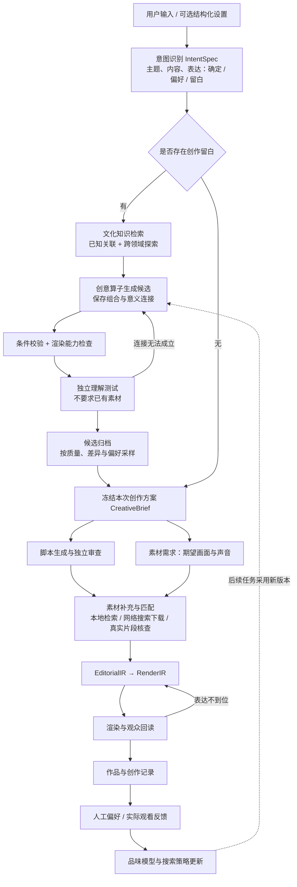

# 创意模块修改计划：主题、内容、表达的条件采样

日期：2026-10-23（北京时间）  
状态：2026-10-23 已接入首版主流程（意图、文化库、候选、独立评审、条件采样、冻结方案、下游评分、恢复和提案偏好反馈）。实现接口和实际边界见 [实现说明](creative-render-implementation.md)。以下保留原始设计；多候选视听小样和成片 A/B 窗口仍属于后续扩展。

当前产品要求以 [产品需求文档](product-requirements.md) 为准。本文保留历史方案和旧路径；运行时已经改为 pi-agent-core，创意评审不要求实际素材，检索、下载与片段匹配在脚本后的素材补充阶段完成。

## 目标与基本约定

一次 Agent 运行，是在用户确定的“主题、内容、表达”条件下，对剩余创作空间进行一次采样。用户可以确定任意维度，也可以只确定维度中的部分字段；无需填写完整表单。

创意模块负责主动发现文化元素之间可被目标观众理解的联系，并把创意落成可执行脚本。新颖性、可理解性、情绪效果、素材可行性和用户偏好分别记录，不能把随机拼接或模型自我肯定当作成功。

原方案沿用 Claude Agent SDK，现已由 pi-agent-core 替代；当前工作台见 [pi 工作台说明](pi-workbench.md)。DeepSeek、SQLite、本地媒体分析、本地 TTS、EditorialIR、RenderIR、HyperFrames 和 FFmpeg 继续服务制作流程。除大模型 token 外，不引入额外付费服务依赖。保留现有不限费用和不限修订轮数的配置语义。

## 当前实现需要调整的位置

- `src/script-revision.ts`：目前直接围绕用户提示词生成中文短视频脚本，需要改为使用意图识别与选定创意的产物。
- `src/workflow.ts`：目前脚本之后进入剪辑、布局和渲染，需要在脚本阶段加入创意子流程，并将状态、检查点和缓存依赖串起来。
- `src/scoring.ts`：目前后续评审直接以原始提示词作为对齐目标，需要区分用户固定条件与本次自主选择的创意。
- `src/domain.ts`、`src/store.ts`：扩展结构化产物和文化知识、候选、反馈、版本数据。
- `src/agents.ts`、`src/learning.ts`：增加文化检索、原子创意算子、独立评审和品味学习的工具与职责。
- `src/cli.ts`、`src/service.ts`：支持查看意图、候选、采样结果与反馈；兼容已有任务。

上述路径表示预期改动范围，具体模块拆分在实现时确定。

## 1. 意图识别：IntentSpec

| 维度 | 描述什么                 | 可以确定的部分                                |
| ---- | ------------------------ | --------------------------------------------- |
| 主题 | 这条视频关于什么         | 人物、作品、现象、问题、事件                  |
| 内容 | 具体讲什么、发生什么     | 观点、事实、情节、台词、事件顺序              |
| 表达 | 通过什么形式让观众感受到 | 叙述视角、Persona、音乐、风格、节奏、视听反差 |

每个维度内部支持“已确定、偏好、留白”三种状态。状态落实到字段，不是给整个维度设置一个布尔锁。

| 用户输入                       | 已确定                   | 可以生成的部分                   |
| ------------------------------ | ------------------------ | -------------------------------- |
| 剪一条 Dante 的视频            | 主题中的角色             | 内容、视角、音乐、叙事与剪辑表达 |
| Dante 上班，用 Funk，其他随意  | 角色、上班情境、音乐风格 | 具体冲突、台词、反转、画面组织   |
| 这段旁白一字不改，画面自由发挥 | 内容中的旁白原文         | 视觉隐喻、素材组合、镜头与音乐   |
| 随便来一个有意思的创意         | 没有指定主题和内容       | 三个维度共同采样                 |

`IntentSpec` 记录每条条件的维度、字段、取值、确定程度、用户原句、来源和识别置信度，以及必须保留、允许变化和明确禁止的内容。

规则：

- 模型推断不能自动升级成用户硬要求。
- 账号历史偏好默认影响采样权重；用户本次明确指定的内容优先。
- 原文精确保留与语义保留必须区分。
- 路径权限、素材来源、输出规格继续单独执行，创意模块不能扩大权限。
- 全部创作内容已经确定时，跳过不必要的发散，直接实现。
- 旧任务保留原执行语义，不因新增创意模块而自动重采样或改写已接受产物。

## 2. 工作流

一次运行内部可以探索多个候选，最终采样一个方案进入制作。搜索批次只是调度单位，不是总费用或总轮数上限。完成一次有效采样后进入制作，重新采样是另一个明确操作。

不固定为“生成十个、永远取模型评分最高者”。需要保留不同方向的可行方案及探索机会。

## 3. 文化知识库

继续使用 SQLite，增加实体、关系、来源与索引表；结合本地 embedding，实现关键词检索、语义检索和关系遍历，无需先引入独立图数据库。

| 数据       | 关键内容                                         |
| ---------- | ------------------------------------------------ |
| 文化实体   | Meme、人物、角色、作品、音乐风格、热词、生活情境 |
| 文化关系   | 出自、改写自、反差于、经常搭配、代表某种情绪     |
| 使用语境   | 哪类受众熟悉、典型用法、容易误解之处             |
| 时间信息   | 观察时间、最近核验时间、流行度证据               |
| 来源与状态 | 来源、事实、来源叙述、模型推断、创作假设         |

“台词出自作品”属于有来源的知识；“台词适合某角色”属于待验证的创作假设。两者分开保存，避免模型生成的关联反过来被视为事实。

首批接入：

1. Wikidata、Wikipedia：人物、作品、背景和已有关系。
2. 公开网页、用户链接与文化资料：提取 Meme、热词和案例，保留来源与时间，不预设所有平台都有稳定免费 API。
3. 现有视频学习管线：从 ASR、帧和音乐分析中提取情境、表达方式与素材线索。
4. 本地素材库：动作、台词、构图本身也可以触发创意。

知识检索与素材下载分别配置。`local_only` 可以允许文化背景检索，但成片仍只使用授权本地素材。账号知识、共享文化知识和评测数据保持隔离。

参考接口：

- [Wikidata 数据访问](https://www.wikidata.org/wiki/Wikidata:Data_access)
- [MediaWiki REST API](https://www.mediawiki.org/wiki/API:REST_API/Reference/en)

## 4. 创意算子、候选与采样

首版原子算子：语境迁移、角色反转、情绪反差、叙事结构迁移、台词变体、视觉类比。

每个算子声明读取和修改哪些字段。用户固定台词时，台词变体不能修改它，但其他留白仍可探索。

每个候选保存为 `ConceptIR`，表示脚本之前的创意记录，不替代现有剪辑和渲染 IR。内容包括：

- 主题、内容、表达的完整提案。
- 使用的文化元素、来源和创意算子。
- 元素间的联系、被打破的预期。
- 受众需要掌握的背景、预期情绪效果。
- 用于表达联系的具体画面或声音。
- 素材需求、已有证据、尚未验证的假设。

Harness 负责选择探索领域、调用算子、去重和保存候选。搜索覆盖近邻联想、跨领域关联和历史上较少探索的方向。

候选分别记录可理解性、渲染能力要求、素材需求、相对已有作品的差异、预期情绪效果和偏好匹配。2026-10-23 修订：素材是否齐全不作为创意通过条件；先确定创意，再在脚本后的素材补充阶段检索、下载、核查。基本条件通过后，从不同方向的候选中加权采样，避免同一种风格垄断结果。新颖性只相对于已检索与归档的材料，不宣称全球原创。

记录知识快照、算子版本、候选、随机种子与选择过程；随机种子可复现采样选择，不保证远程模型重新生成逐字相同的响应。已保存候选用于检查点恢复。

## 5. 评审目标

| 检查         | 判断依据                          | 作用                         |
| ------------ | --------------------------------- | ---------------------------- |
| 指令遵循     | IntentSpec 中用户确定的条件       | 防止擅自改主题、台词、音乐等 |
| 表达是否成立 | 冻结 CreativeBrief 与独立观众理解 | 判断本次创意是否真的表达出来 |
| 是否值得看   | 独立评价、人工偏好、观看反馈      | 影响排序与后续学习           |

原始提示词中的开放部分不再参加严格相似度门槛。独立观众看实际脚本、画面和声音，以及预先声明的受众背景，不看创作者对“为什么这个梗妙”的解释。

音乐反差、节奏和视觉错位需要时制作短小样；仅凭文字提案不能确认视听效果成立。

选定方案后冻结 `CreativeBrief`。失败可以修表达或返回创意搜索，不能悄悄重写用户条件或验收目标。创意变更使相关脚本、旁白、IR 和评审缓存失效。

## 6. 品味学习

将创意生成、独立评价和人类偏好分开：

- 收集人工 A/B 比较、是否看懂、是否愿意继续看的反馈。
- 支持“都不好”和“无法比较”。
- 区分创意提案、小样和最终成片反馈，区分点子与执行问题。
- 数据足够后训练本地成对偏好排序模型，按账号和受众建模。
- 保存算子适用条件和失败反例，据此更新搜索概率。
- 模型自评只作为弱证据，不当作人类偏好循环训练。
- 观看反馈保留曝光与发布条件，不把完播率等指标直接解释为创意质量。

搜索策略、品味模型和文化知识按版本发布，运行中任务固定版本。正式 benchmark 运行隔离学习写回，并遵循任务规定的自主范围。

## 7. 实施顺序

1. **意图协议与评审改造**：增加 IntentSpec、CreativeBrief、字段级确定与留白；先建立指令遵循与自主创作的边界。
2. **知识库与创意搜索**：文化实体、关系、来源、算子、候选归档和采样器。
3. **接入真实制作**：素材可行性检查、小样、脚本与双层 IR；支持检查点恢复、重新采样及缓存失效。
4. **反馈与品味学习**：扩展人工审核页，增加候选对比、A/B 反馈和偏好模型。

## 8. 验收

- 覆盖主题、内容、表达全部八种确定/留白组合，以及字段级部分约束。
- 用户固定条件、明确禁止项与精确保留文本不被创意算子修改。
- 多次采样在留白维度产生实际差异，不能只换措辞或标题。
- 空素材库不阻塞创意、不自动改成纯字卡。缺少素材时在素材补充阶段搜索与匹配；仍无法补齐则保存缺口，保留创意和脚本，不编造素材、不反复重写创意。
- 独立观众上下文不泄露创作者解释和预期答案。
- 断点恢复保留已选创意，版本变更正确使下游缓存失效。
- 用户可以查看哪些来自原始要求、哪些来自本次采样，以及文化来源和选择记录。
- 品味反馈与模型预测分别保存，账号记忆、用户真实经历和虚构 Persona 不混用。
- 所有新增工具与后台知识采集遵循现有路径和素材权限。
