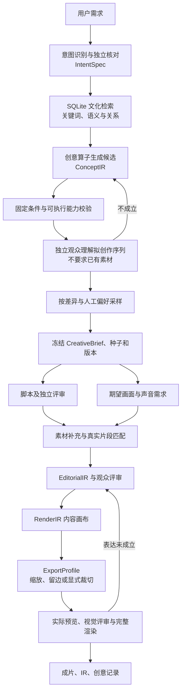

# 构图与导出分离、创意流程接入

2026-10-23。本文件说明已落地的接口和边界。原始设计保留在 [创意计划](creative-module-plan.md)。

## 两层参数

`EditorialIR` 定义剪什么、何时出现；`RenderIR.canvas` 是内容设计画布，节点位置、字形大小、动画基于这块画布。`ExportProfile` 单独定义视频文件的分辨率、帧率、背景和画幅适配策略。导出不会重写两个 IR。

```json
{
  "prompt": "解释奥迪霍希 A8L 的品牌历史，角度和表达自由发挥",
  "materials": { "paths": ["/absolute/path/to/materials"], "strategy": "local_only" },
  "composition": {
    "aspectRatio": "auto",
    "mediaFit": "contain",
    "fps": 30
  },
  "output": {
    "aspectRatio": "16:9",
    "height": 1080,
    "fps": 30,
    "fit": "contain",
    "background": "#000000",
    "duration": 90
  },
  "creative": { "enabled": true, "knowledge": "local", "seed": "experiment-1", "batchSize": 4 }
}
```

| 参数                       | 含义                                                                                                     |
| -------------------------- | -------------------------------------------------------------------------------------------------------- |
| `composition.aspectRatio`  | 内容画布比例，支持 `auto` 或正整数比例，例如 `16:9`、`4:3`、`4:5`；`auto` 按已选视觉素材选择常见参考比例 |
| `composition.width/height` | 可直接固定设计尺寸，二者同时提供                                                                         |
| `composition.mediaFit`     | `contain` 默认完整保留素材；`cover` 显式允许布局裁切                                                     |
| `output.aspectRatio`       | 导出比例，可独立于内容画布                                                                               |
| `output.width/height`      | 可同时指定尺寸；有比例时允许只指定一边；冲突和奇数尺寸会拒绝                                             |
| `output.fit`               | `contain` 等比缩放后留边；`cover` 等比铺满后裁切。无自动拉伸                                             |
| `output.fps`               | 最终采样帧率，独立于设计画布；时长仍属于剪辑内容，不能通过重新导出修改                                   |

`contain` 会检查素材、祖先分组、遮罩和动画是否越界，避免布局偷偷裁掉原图。整个构图从横屏导出竖屏时会保留上下留边；想重新排成竖屏，需要新的布局并重新评审。导出已有的被裁切布局不会恢复已丢失的画面。

```bash
node dist/cli.js create --input task.json
node dist/cli.js run TASK_ID
node dist/cli.js export TASK_ID --ratio 16:9 --height 1080 --fps 30
node dist/cli.js export TASK_ID --ratio 4:3 --height 1080 --fps 30
node dist/cli.js export TASK_ID --ratio 9:16 --width 1080 --fps 30
```

`export` 复用已接受的剪辑和布局，每种规格保存在 `render/<composition-hash>/exports/<export-hash>/`，附 `export.json` 和参考画布的可见面积比例（不包含布局内部的显式裁切）。重新导出的文件标记 `aiReviewed:false`，不会覆盖原来通过评审的 `render` 产物。CLI `render --editorial ... --layout ...` 也接受这些导出参数。

API：`POST /tasks/:id/exports`，请求体为 `{ "aspectRatio": "4:3", "height": 1080, "fps": 30, "fit": "contain" }`。接口等待渲染完成，使用任务 lease 防止并发修改。

## 新任务的创意流程



新任务默认启用；schema 5 在备份后为历史任务补全规范配置，其中此前没有 `creative` 字段的任务明确设置 `enabled:false`，保留其已接受产物。运行时只读取规范配置。`--no-creative` 或 `creative.enabled=false` 可显式关闭。

- 主题、内容、表达支持字段级 `fixed/preferred/open`。`field="*"` 仅表示整个维度；原文保留用 `match="exact"`，含义保留用 `semantic`。推断不能升级为用户硬要求。
- 自然语言条件必须附用户原句，并由第二次独立调用核对遗漏和过度锁定。结构化 `creative.constraints` 优先。时长、无声、旁白/音乐/音效限制、只保留旁白、禁止新增字幕/文字、横竖屏、不裁画面、已有素材和源画面一致性进入 `IntentSpec.technical`，用程序检查，不混入文字相似度。
- 六个算子：语境迁移、角色反转、情绪反差、叙事结构迁移、台词变体、视觉类比。固定原文时禁用台词变体。三个维度全固定时只生成忠实执行方案。
- 提案评审只看拟创作的视听序列、受众背景和渲染能力，不读取素材帧、意义解释、预期情绪或用户目标。该阶段验证概念是否成立，不要求素材已经获取，也不声称验证了尚未渲染的效果。
- 创意输出 `creative.material_requirements`，脚本通过后由独立素材 Agent 生成 `materials.requirements`，检索、下载/绑定、抽帧核验。声音先拆为独立的 `materials.sound_plan`；静音不检索，复合声音分别匹配。真实缺口保存为 `materials.gaps`，以 `MATERIALS_MISSING` 停在素材匹配，保留创意和脚本。不会因空库而把实拍方案降为字卡。
- 选定后分别检查用户固定条件和方案的可观察表达承诺。视觉承诺不能靠旁白通过。仍使用固定本地模型和原来的 `distance < 0.15` 阈值；无硬条件的自由创作不再强行匹配开放提示词。
- 脚本、剪辑和布局均读取同一冻结方案；独立脚本观众、剪辑观众和视觉观众不读取创作者解释。确切旁白必须使用完整的已合成音频。
- 全部阶段与 Agent 预算继续默认 `null`。`batchSize` 是一批候选的数量，不是总轮数或费用上限。

```bash
node dist/cli.js creative TASK_ID
node dist/cli.js creative TASK_ID --resample --seed another-direction
node dist/cli.js resume TASK_ID
```

查看命令返回意图、候选、评审、冻结方案和选择概率。`resample` 要求任务不在运行：保留素材、记忆和历史记录，开始新一代创意，旧脚本、旁白、IR、评分及待评审候选全部失效。普通 `resume` 复用已保存的候选和选择。2026-10-23 的 concept-first-v4-technical-constraints 更新会使尚未通过的旧意图、候选与评审失效，保留种子和历史，重新生成候选；已接受方案保持不变。

API：`GET /tasks/:id/creative`、`POST /tasks/:id/creative/resample`（`{ "seed": "..." }`）。产物也可通过原 `artifacts/:stage` 接口查看。

## 文化知识与人工偏好

SQLite 保存文化实体、关系和来源，使用内容哈希防止后续检索覆盖已冻结证据。来源叙述、推断、创作假设分开，不把源人物经历当作账号事实。

`creative.knowledge="local"` 只读已有文化资料与授权素材；`"web"` 允许免费 Wikipedia 搜索和公共 HTTPS 网页读取。采用 [MediaWiki Search API](https://www.mediawiki.org/wiki/API:Search)，不需要额外 Key。网页通过同一 ProcessRunner 沙箱，限定公共地址、固定实际连接地址、禁止重定向、限制响应体，记录来源原文和实际读取时间。Agent 引用必须能在已读取文本中找到，网络失败不伪造资料。`local_only` 仍只约束成片素材来源。

普通任务的知识按账号隔离；无账号时按任务隔离。后台视频学习通过独立评审的公开网络来源会追加共享文化资料；本地私人来源不进入共享文化表。

```bash
node dist/cli.js culture TASK_ID --input culture-bundle.json
node dist/cli.js culture TASK_ID --query "人物 反差 都市生活"
node dist/cli.js creative-feedback TASK_ID --input preference.json
```

`culture-bundle.json` 使用 `sources/entities/relations`；Schema 在 `packages/core/src/creative-domain.ts`。API 为 `GET/POST /tasks/:id/culture`。

人工比较示例：

```json
{
  "expectedVersion": 1,
  "left": "concept_A",
  "right": "concept_B",
  "choice": "left",
  "level": "concept",
  "audience": "default",
  "comment": "这个连接更容易看懂"
}
```

`choice` 支持 `left/right/both_bad/incomparable`。API 为 `POST /tasks/:id/creative/feedback`。`expectedVersion` 来自审阅时 `creative.compare` 返回的 `taskVersion`；示例的 1 必须换成实际审阅版本，任务变化后重新审阅。TUI 使用 F6 或 `/compare` 查看、`/prefer` 选择；CLI/API 复用同一命令。同一对候选的重复反馈更新原记录，不重复投票，变更保留事件历史。至少五组有效人工比较后启用本地成对 logistic 排序，影响后续采样权重；运行中任务使用冻结权重，模型自评不会进入训练表。

当前反馈接口只支持创意提案比较。新增 `strategy` 学习实验从这些人类偏好中总结适用条件、机制和反例，通过独立题材的盲测后才发布到后续任务，流程见 [创作方法学习](pi-workbench.md#学习与版本)。工程测试验证了数据与发布边界，真实偏好效果仍待验收。多候选自动生成短小样、成片 A/B 审核窗口、独立验证的文化事实库与跨平台热词订阅尚未实现；不能把当前实现称为已经学会用户品味。这些是原计划中后续扩展项。当前执行能力以真实剪辑/布局 IR 能表示的内容为准。

## 数据版本与验证

新 RenderIR 使用 `animationTimebase="binding"`，media/text 的关键帧时间从镜头或文字开始时刻计起，group 从全片开始。旧 IR 缺少该字段时维持全片时间语义。参考画布与导出配置进入不同哈希，避免导出文件互相覆盖。

新增测试覆盖八种确定/留白组合、原句校验、精确文本、语义冲突、视觉证据、知识及偏好隔离、恢复和重新采样；集成测试实际用 Chromium/HyperFrames/FFmpeg 导出三种画幅，检查源画面两侧标记、帧率和后段动画。另有完整创意到渲染的 fixture Agent/NLI 测试；它验证管线正确性，不证明真实模型的审美质量。
