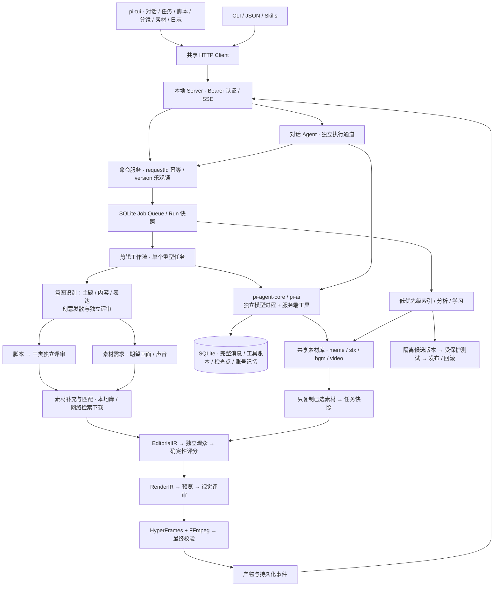

# pi 视频剪辑工作台

2026-10-23，FilmEdit 0.2.0。本文记录此次已实现的架构、迁移方式和操作入口。创作方法仍见 [创意计划](creative-module-plan.md)，画布与导出策略见 [构图说明](creative-render-implementation.md)。

## 总体架构



Pi 的三个包固定为 1.4.0。Claude Agent SDK 依赖和调用已移除；Sandbox Runtime 保留为操作系统沙箱。pi 管理单个 Agent 的模型/工具循环，FilmEdit 管理阶段、质量门、任务队列、恢复和版本；没有再叠加 coding-agent 或 durable 任务引擎。

CLI 和 TUI 都是客户端，不直接打开业务数据库。Server 是当前 FILMEDIT_HOME 的唯一调度入口，SQLite 在服务端同步写入；媒体、浏览器和模型子进程不写数据库。模型子进程只能通过 JSONL 请求主进程执行注册工具，没有通用终端或任意文件工具。

创意先于素材：创意生成和概念评审不读取素材库、抽帧或 ASR。概念评审检查联系是否可理解以及渲染能力。脚本通过后，由独立素材 Agent 在 `materials` 阶段补齐需求；`materials.requirements` 保存需求，`materials` 保存已检查的素材和源片段、观察证据、内容哈希。缺口保存为 `materials.gaps`，任务以 `MATERIALS_MISSING` 停在素材阶段，保留创意和脚本。剪辑 Agent 只组织匹配表中的已核验片段，无搜索或下载权限。最终观众和渲染评审继续核查实际内容。

`local_materials` 分页浏览当前授权来源，`import_local_material` 导入选中文件并返回任务内 assetId，继续走同一套 frame/ASR/beats 核验。任务启动不再批量导入 `materials.paths`；素材角色按需发现并匹配。脚本与事实审查也可按需读取用户已授权的源内容，以支撑来自采访、字幕或实拍的事实，但没有网络素材搜索、下载或共享库绑定能力。创意与独立观众不获得这些目录工具。目录发现不创建第二套索引、不扩大权限，也不自动发布到共享库；恢复已有上下文前仍校验已索引来源的权限与哈希。

`local_only` / 用户“只用本地素材”约束检索来源，不要求创意阶段素材齐全；`source_grounded` 表示画面应有真实素材依据，并不禁止后续下载。风格或画面要求使用语义匹配，`exact` 仅用于明确要求保留原文的文字。新创意评审版本不会复用旧的素材前置评审及其退稿反馈；已通过的创意和历史产物保留。

## 代码组织

| 目录                      | 职责                                                |
| ------------------------- | --------------------------------------------------- |
| `apps/cli`                | CLI 参数、pi-tui、用户交互；不实现剪辑逻辑          |
| `apps/server`             | localhost API、SSE、预览票据、daemon 锁及生命周期   |
| `apps/worker`             | pi 模型进程、沙箱启动器、HyperFrames/学习编译子进程 |
| `packages/core`           | IR、需求、构图/导出、命令 Schema 与 CLI 参数契约    |
| `packages/application`    | 任务状态机、对话编排、队列、改稿、创意与学习流程    |
| `packages/agent-runtime`  | Agent 驱动、原子工具、pi IPC、工具账本和恢复        |
| `packages/library`        | 共享素材索引、查询、分析、绑定与缓存                |
| `packages/media`          | FFmpeg、渲染、音频、ASR/TTS、抽帧、布局和质量检查   |
| `packages/infrastructure` | SQLite、权限、子进程、凭据配置、版本发布            |
| `packages/client`         | HTTP Client、SSE 重连、本地服务发现                 |
| `skills`                  | 对话、素材库和生产原子技能说明                      |

工程使用 npm workspaces。先构建，再运行 `dist/cli.js`。Node 最低 22.22.0，模型 Worker 使用 `--use-env-proxy` 接入沙箱代理。不要把代理问题通过关闭沙箱来解决。

## 启动与 TUI

```bash
npm ci
npm run build
npm start
# 或 node dist/cli.js tui
```

第一次运行自动启动后台 Server，连接信息位于 `FILMEDIT_HOME/daemon.json`，权限 0600；日志是同目录的 `server.log`。随机 token 不输出到终端。`FILMEDIT_API_TOKEN` 非空时可固定 token。只监听 127.0.0.1，不开放跨域 API。

TUI 默认恢复最近对话，一个对话可以管理多个任务；当前任务显示在右侧，消息发出时绑定任务，发送后切换焦点不会把旧消息应用到另一个任务。

- F1–F6：对话、脚本、分镜、素材、日志、创意。
- `/compare`：读取两个已归档创意；`/compare a` 或 `/compare b` 分页选择候选；`/prefer` 提交用户偏好。
- Ctrl+T：任务选择；Ctrl+N：新对话；`/history`：历史对话。
- Ctrl+O 或 `/preview`：在本地浏览器播放最近输出，支持 Range 请求。票据一小时过期。
- `/artifacts`：选择阶段产物或历史版本；`/artifact ID` 读取并引用。
- `/use lib_ID`、`/shot shot_ID`：下一条消息带上素材/镜头引用。
- `/pause`、`/resume`、`/cancel`：任务控制；Ctrl+C 只退出 TUI。
- `/review script`、`/review editorial`：读取结构化脚本、旁白、镜头时间段和音轨。
- `/revise script 修改要求`、`/revise editorial 修改要求`、`/revise layout 修改要求`：提交改稿。
- `/export 16:9`：复用 IR 导出新规格。

输入中文自然语言同样可操作。模型先读命令 Schema，再提交结构化命令；明确请求直接执行，只讨论时不创建任务。需要必要信息时调用 ask_user，结束当前对话轮，等待下一条消息。对话和剪辑采用独立执行通道，渲染期间仍能对话。

终端中查看结构化产物；视频交给浏览器预览。没有手动拖拽时间线，也没有声称在所有终端原生播放视频。窄窗口自动隐藏两侧面板；PageUp/PageDown 滚动，编辑器支持中文和多行输入。

## CLI 和 API

```bash
node dist/cli.js chat '先讨论一个创意'
node dist/cli.js chat '继续' --conversation CONVERSATION_ID --task TASK_ID
node dist/cli.js create --prompt '剪一条汽车片' --composition 16:9 --ratio 16:9
node dist/cli.js run TASK_ID
node dist/cli.js status TASK_ID
node dist/cli.js pause TASK_ID
node dist/cli.js resume TASK_ID --wait
node dist/cli.js export TASK_ID --ratio 4:3 --height 1080 --wait
node dist/cli.js schema task.revise
node dist/cli.js task revise TASK_ID --json '{"expectedVersion":1,"kind":"editorial","instruction":"前3秒加快节奏"}'
node dist/cli.js command job.inspect --json '{"id":"job_ID"}'
node dist/cli.js server status
node dist/cli.js server stop
```

`run/resume/export` 返回持久化 job。`--wait` 只让客户端等待，断开客户端不会取消 job。`serve --port 8787` 保留为前台启动方式；同一个 HOME 不允许两个新 Server 同时启动。更改 `.env` 后重启 Server。

主要新增 API：

| 接口                                   | 用途                                                            |
| -------------------------------------- | --------------------------------------------------------------- |
| `POST /commands`                       | `{requestId, command, args, taskId?}`，所有结构化命令的统一入口 |
| `GET/POST /conversations`              | 历史对话与新建对话                                              |
| `PUT /conversations/:id/focus`         | 当前任务，允许 null                                             |
| `GET/POST /conversations/:id/messages` | 消息持久化、分页、排队                                          |
| `GET /events?after=SEQ`                | 全局单调递增事件；支持 Last-Event-ID、任务/对话过滤             |
| `GET /jobs/:id`                        | 后台执行状态及错误                                              |
| `GET /tasks/:id/runs`                  | 不可变输入快照、版本、结果引用                                  |
| `GET /tasks/:id/artifacts`             | 历史产物元数据                                                  |
| `POST /tasks/:id/preview`              | 签发当前视频的短期只读预览链接                                  |

已有账号/记忆、创意、任务、学习、发布接口保留。API 写请求需 JSON 和 Bearer token；预览只凭随机票据访问对应文件，不能传任意路径。

## 状态、恢复和改稿

任务：queued → running → completed；可进入 pausing/paused、blocked、cancelled。Job 和 Run 单独记录状态。必要追问的 `waitingInput` 属于对话结果，不会把仍在执行的剪辑误标成等待用户。

- Server 每次启动将中断中的 job 重新排队。正常退出先取消子进程，保存检查点。
- Agent 的每条完整消息在进入下一步前写入 SQLite。工具执行先记 intent，完成后保存结果；恢复时复用已完成 callId 的结果。
- 暂停会传递 AbortSignal 到模型、FFmpeg、Python 和浏览器子进程。媒体进程监督器跟踪子进程及 Chromium 的独立进程组，先请求退出、必要时强制终止，确认清理后才返回；超时和输出超限使用同一路径。清理无法确认时明确报错，不把尚有子进程存活记为正常取消。
- requestId 防重复点击/重试；expectedVersion 防过期改稿。Run 固定任务配置、权限版本、发布版本、产物引用，运行中不会切换后台学习版本。
- 脚本修改使旁白及之后的阶段失效；剪辑修改保留脚本；布局修改保留剪辑；output 修改只生成新导出。旧文件和历史产物仍可审阅。
- 人工修改带上旧产物和明确指令，后续评审反馈不会覆盖原始修改要求。
- Schema 或证据格式错误在同一 reviewer loop 中修复；只有叙事/画面本身不合格才回到创作阶段。
- 无默认金额/轮数上限。费用继续记录；显式配置的预算仍生效。

脚本学习发布后的知识维护也通过命令服务执行：`learning.knowledge` 按实验分页查看原内容与撤回状态，`learning.retract` 接收实验 ID、记忆 ID 和原因，原子移除记忆、索引和关联文化条目。撤回事件保留完整来源，任务快照不变；只接受用户直接提交，不开放给模型自动调用。账户记忆继续使用 `memory.correct/remove`，已发布剪辑手法使用版本回滚，职责不混用。

SQLite 保存完整消息和工具结果；模型上下文超长时保留最新完整工具批次，压缩较早记录。素材列表、ASR、检索结果保持分页，事件流不广播图片 base64。

任务记忆在首次运行时冻结。明确账号设置按账号与来源单独查询，不受全局知识检索条数影响；初始上下文另取近期 20 条用户反馈、8 条 Persona 候选及最多 30 条主题相关记录，按 ID 去重。上述检索窗口不删除完整记忆库，仍可按需检索。意图提取只读取本次用户输入与显式配置，不读取历史偏好；创作阶段再使用记忆补充留白。恢复任务保留旧快照，新任务读取已纠正的记忆。

## 作品反馈

任务 `completed` 表示制作完成，产物的 `accepted` 表示流程校验通过；用户是否接受单独记录在 `task.feedback` 事件中。自由创作和账号模式共用同一入口，不新增另一套任务状态或数据库表。

TUI 操作：

```text
/preview
/feedback accept 这版可以采用
/feedback reject 画面没有表达出反差
/feedback changes_requested 开头节奏需要调整
/feedback comment 第二个镜头主体太小
/feedback
```

正式结论必须指向当前已完成的成片。`/preview` 或选择具体产物时保存任务版本和产物 ID；切换任务清除选择，任务或成片更新后拒绝过期结论。`comment` 可以针对中间产物或整个任务记录。反馈并不启动制作，实际修改仍走 `task.revise`。

CLI/API 使用同一命令服务。先读取任务，再把实际审阅的版本和产物填入反馈；不要在提交前自动换成刚查询到的新版本。

```bash
node dist/cli.js task inspect TASK_ID
node dist/cli.js task feedback TASK_ID --json '{"expectedVersion":1,"artifactId":"ARTIFACT_ID","decision":"accept","dimensions":["creative","execution"],"content":"反差能看懂，节奏合适，可以采用"}'
node dist/cli.js task feedback.list TASK_ID --json '{"limit":20}'
```

`dimensions` 可选值为 `creative`、`content`、`execution`、`technical`，不分类时传空数组。历史分页使用返回的 `nextBefore` 作为下一次的 `before`。任务详情、任务列表和流程审阅页分别显示当前结论及具体产物的反馈。新版不继承旧版结论；同一成片的重复输出引用按产物哈希关联。

对话工具只允许保存本轮用户原话，且必须绑定该消息原本关联的任务；不能转述成模型评价、引用另一个任务的消息，或提交 `accept/reject/changes_requested`。用户通过直接入口给出的结论才参与正式采用状态。反馈来源由服务端设置，模型参数不能伪造。

创意成对偏好 `creative.feedback` 同样只接受用户通过 TUI/CLI/API 直接提交。对话中询问“哪个创意好”允许 Agent 分析差异，但不允许把模型的选择写成 `human` 训练样本。两种模型工具入口与重试的请求来源检查均执行这一规则。

F6 或 `/compare` 展示两个已归档提案：主题、内容、表达、创意联系、拟制作的画面与声音，以及未验证事项。宽屏并排、窄屏上下排列；PageUp/PageDown 翻阅正文。`/compare a`、`/compare b` 按页选择，也可 `/compare ID_A ID_B`。`/prefer` 打开四种选择，或直接 `/prefer left|right|both_bad|incomparable 意见`。这里只评提案，不声称已看到短小样或成片，也不要求素材已到位。

读取使用 `creative.candidates`（游标 `before`、每页 `limit`）和 `creative.compare`（`left/right/audience`）；后者返回 `taskVersion`。提交将它原样写入 `creative.feedback.expectedVersion`，不能在提交前静默更新版本。服务端检查两个候选属于该任务，任务变更后拒绝旧选择。同一对候选更换 A/B 位置时，历史偏好随候选转换；重复选择不增加训练样本，修改选择保留事件记录。比较和投票不改当前制作方案、不启动生产。

账号存在时，同一事务把意见保存为带任务版本、产物和反馈 ID 的账号记忆；没有账号则只保存作品反馈。请求重试不会重复写入，账号记忆纠正或删除不会抹除原始反馈记录。这里记录的是用户输入，不证明品味学习已有效。

## 共享素材库

```bash
node dist/cli.js library import /absolute/path/to/videos --category video --tag 汽车
node dist/cli.js library import /absolute/path/to/music --category bgm
node dist/cli.js library import /absolute/path/to/memes --category meme
node dist/cli.js library search --query 紧张 --category bgm
node dist/cli.js library search --query 紧张悬疑 --semantic
node dist/cli.js library analyze LIB_ID --features frames,vision,asr
node dist/cli.js library analyze LIB_ID --features audio,beats
node dist/cli.js library bind LIB_ID --task TASK_ID
node dist/cli.js library refresh
node dist/cli.js skills read library
```

索引视频、图片、GIF、音频、字幕。四类是用途分类，同一素材可属于多类；静态 WebP 可作为图片。递归导入不跟随符号链接，按内容哈希去重，原始文件不被修改。导入后后台生成关键帧或音频统计，ASR、节拍、视觉理解按需分析；相同内容复用缓存。视觉理解使用配置的大模型，其他分析和语义模型在本地。

检索支持 SQLite FTS、类型/时长/方向过滤，`--semantic` 使用本地固定版本语义模型。检索分数和候选范围只是建议；创作 Agent 必须 bind 后用真实帧/ASR 验证，不能把检索描述当成独立评审证据。

Library ID 以 lib_ 开头，绑定后得到任务 assetId。绑定时复核来源哈希，仅复制被选择的素材并复用分析结果；缺失或变化会报错。删除库索引不删除源文件，也不破坏已有任务快照。

共享库不增加逐任务授权选择。但导入和额外路径访问仍须来自用户提供的明确路径；模型不能靠猜路径扩大访问。生产 Agent 只能 search/inspect/bind，库管理交给对话层/CLI；观众 Agent 不读取共享库检索说明。

## 学习与版本

创作方法学习使用同一实验队列的 `kind=strategy`，配置为 `scope`（账号或任务）、`audience`、可选 `usd`。不传视频、路径或素材权限：输入只来自该范围的真实提案比较。`application/strategy-learning.ts` 管理分组、训练/保留集、预测和原子发布；`infrastructure/strategy-store.ts` 管理来源一致性、题材使用记录与活动版本；`core/creative-strategy.ts` 定义结构与固定的发布判定。它们复用 experiments、artifacts、settings 和事件，不增加数据库表或迁移。

一次实验提出一个方法集合，最多六条，每条记录适用条件、机制、禁用情境、支持与反例引用。保留集按独立题材分组，每个题材只取一票，至少五组、最多二十组；题材独立性由无标签的分组 Agent 判断，程序额外阻止相同规范化主题被拆组。别名、IP 或相近题材的语义判断仍可能有误，需要真实数据复核。

基线为实验开始时的已发布方法（没有则不提供方法）。两者均通过独立预测 Agent 预测同一批未知人类选择，每组分别交换左右位置；不一致记为未能预测。v1 发布条件：正确率至少 0.75，至少五个相对基线的正确改进，单侧配对符号检验 p≤0.05。规则、来源、数据划分、预测和评估都存盘；失败不会据保留集答案重写候选。后续实验必须获得新题材，不能反复使用测试集调参。阈值属于固定工程门槛，尚未校准为通用审美指标。

创作 Agent 从冻结的 `creative.sampling.taste.strategy` 接收已发布方法建议；意图识别和独立观众不接收方法。建议不能成为用户固定要求。来源投票变化会让活动版本变为 stale，后续任务不再使用；`creative.strategy.retract` 由用户直接撤回，历史任务与实验保留。已完成实验重跑不会重新激活撤回版本。

学习实验由同一个 Server 调度，优先级低于剪辑；前台任务排队时可以中断背景分析，随后复用缓存继续。`learn --daemon --interval 300` 把空闲学习开关持久化，不再启动另一套长期进程；可以用 `command learning.configure --json '{"enabled":false}'` 停止持续学习。默认没有主动开启连续学习。

学习可修改的代码收窄在 `packages/media/src/compositor.ts`、`techniques.ts`、其 extensions 目录和允许的创作 skill。渲染调度 `render.ts`、权限、评分器、测试、Server、数据库及运行时都不能由学习补丁修改。候选发布复制整个 workspace，经过编译、受保护测试和保留素材评测后激活。

RenderIR 的基础矩形和锚点尺寸使用父容器的归一化比例，全画面是 `[0,0,1,1]`；画布宽高、字体大小和动画位移使用像素。把像素尺寸写进基础矩形会在输入校验时拒绝，由生成该产物的 Agent 修订。

手法比较保留绝对亮度和空间差异作为诊断，验收比较时间上的运动、亮度与空间变化，避免将不同素材的内容差异误判为手法错误。它仍是有限的技术基线，必须配合独立画面评审；不是通用审美分。评分版本变化后先复测已保存的候选，历史结果保留。

## 数据迁移与验证

数据库升级前自动创建本地迁移备份。新增表采用附加迁移；已有任务 ID、账号记忆、成片、IR、人工 review 页面继续保留。备份、任务数据和 `.env` 不随源码发布。

真实 DeepSeek 对话/结构化调用与带图片自检，和使用 fixture Agent 的渲染回归分别验证，不能把测试管线通过等同于作品审美达标。具体运行记录保留在本地。

## 制作任务与学习实验的状态边界

制作或导出结束后，当前输出、运行产物快照、作业完成状态和完成事件在同一个 SQLite 事务中提交；运行快照引用本次输出。写入失败时回滚这次发布，保留此前输出和已经完成的渲染产物供恢复使用。停止信号到达后不发布为完成。

SQLite schema 6 为工作目录记录明确的 `purpose`（production / learning），学习实验通过 `experiments.task_id` 关联它。普通任务列表、任务控制、对话焦点和制作 Runner 只接受 production。学习通过 `learning.list/run` 管理，展示实验状态、工作目录 ID、模型消耗、最近事件和检查点，不把内部目录显示成排队中的创意任务。实验的错误与成功结果分别保存，恢复执行时清除旧错误；中断记为 paused，实际失败记为 blocked。已有数据由显式迁移转换，迁移前备份。

素材匹配增加独立的原始画面评审。匹配 Agent 的描述不作为图片证据交给评审，控制程序提供所选区间的五个取样帧。错误匹配返回素材阶段；报告格式由评审自行修复；中断后继续检查保存的候选。该检查只证明取样画面与需求的关系，剪辑与成片仍需后续完整评审。

每张输入图片紧邻自己的来源/时间标签；Agent 会话缓存绑定图片内容哈希。图片变化后创建独立上下文，不能继续沿用旧证据的中断会话。
