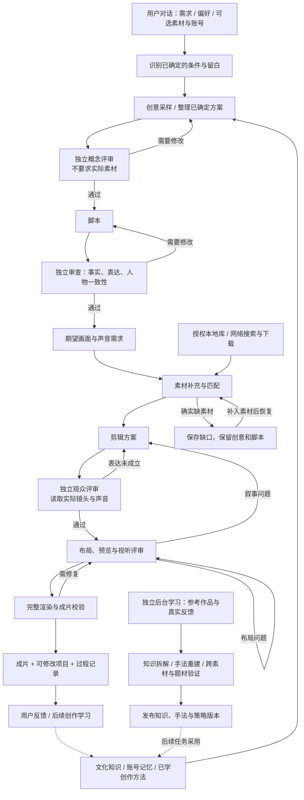

# FilmEdit 产品需求文档：产品目标、核心体验与验收

版本：0.11 · 2026-10-26  
状态：产品目标与需求基线。本文定义要达成的产品，不表示所有能力已经完成。具体运行结果、开发与验收记录保留在本地，不随源码发布。交付顺序不包含工期承诺。

依据：本项目对话中的需求、后续纠正与实际使用反馈，以及仓库中的创意计划、构图说明和 pi 工作台说明。最新用户决定优先于历史方案；技术实现不能反过来缩小用户要得到的结果。

## 1. 要达成什么产品

**FilmEdit 是一个通过对话协作的视频创作 Agent。用户确定主题、内容、表达中的任意部分，Agent 创作剩余部分，主动寻找素材并完成剪辑，交付一件用户愿意采用、可以继续修改的作品。**

核心目标是让用户用自然语言完成一次有创意、可控制、可以反复修改的视频创作。Agent 承担从想法到成片的制作工作，用户掌握创作条件、文件权限和最终采用决定。我们最终要验证的是：用户能否以更少的准备和排错，得到自己愿意使用的作品。

### 三个必须同时成立的结果

| 结果       | 用户应实际感受到什么                                   | 如何判断                                                             |
| ---------- | ------------------------------------------------------ | -------------------------------------------------------------------- |
| 有创作能力 | 只说部分想法，Agent 就能提出值得制作的内容和视听表达。 | 看点、意义联系和情绪能从提案及最终作品中被理解；重新采样有实质差异。 |
| 有制作能力 | 不用自己整理完全部素材、拼接工具和排查每个错误。       | 所需素材被主动获取和核验，镜头与声音兑现方案，成片规格正确。         |
| 有协作能力 | 能随时查看过程、改变主意、精确改稿，继续同一件作品。   | 当前进展真实可见，修改范围正确，暂停和恢复不丢失有效成果。           |

持续学习服务于这三个结果：以后能想出更好的方案、做出更好的片子、减少用户反复解释。知识条数、Agent 数量、评审分数和工具调用次数不是产品目标。

### 产品约定

| 问题           | 产品约定                                                                                 |
| -------------- | ---------------------------------------------------------------------------------------- |
| 为谁做         | 有视频表达需求的个人创作者和账号运营者，尤其是有部分想法、没有完整制作方案的人。         |
| 最小输入       | 一句需求。主题、详细脚本、本地素材和账号均不要求全部提供。                               |
| Agent 负责什么 | 理解固定条件与留白，提出创意，写脚本，补充素材，组织画面和声音，渲染、检查并按反馈修改。 |
| 用户负责什么   | 表达需求和偏好，选择访问范围，审阅作品，决定是否采用；无需手动衔接每个制作工具。         |
| 最终交付什么   | 可播放视频、可继续修改的项目，以及脚本、旁白、素材、时间线和评审记录。                   |
| 什么时候算成功 | 用户明确条件得到满足，创意能从实际画面和声音中被感知，用户愿意采用这一版作品。           |

产品的基本单位是**一件可持续修改的作品**：对话用于协作，任务保存作品和版本，素材库与记忆供后续创作复用。一次对话可以管理多件作品；继续对话、询问进度或重新打开 TUI，不能自动产生另一件作品。用户不需要理解内部 Agent 的数量和调用方式。

### 自主创作与指令遵循如何共存

用户确定主题、内容、表达中的任意部分；首次创作是在这些条件下，对其余部分进行一次创意采样。用户完全确定的内容进入制作，尚未确定的内容允许 Agent 探索。后续“继续”和“改这里”围绕同一作品推进；“换个创意”才触发重新采样。

| 用户输入                     | 已确定部分           | Agent 应创作或执行                   |
| ---------------------------- | -------------------- | ------------------------------------ |
| “做一条保时捷的片子”         | 主题                 | 内容、角度与表达，再找素材制作。     |
| “Dante 上班，用 Funk”        | 角色、情境、音乐风格 | 冲突、情节、台词和视听联系。         |
| “旁白一字不改，画面自由发挥” | 旁白原文             | 镜头、视觉表达、节奏与声音配合。     |
| “随便来一个有意思的创意”     | 没有指定创作条件     | 共同探索主题、内容和表达。           |
| 已给出完整脚本、分镜和风格   | 主要创作内容         | 按要求制作，只在未确定部分自主选择。 |

**先有创意，再补素材。** 文化知识帮助联想，创意和脚本提出画面与声音需求，素材阶段再获取真实文件。创意评审不要求素材 ID、下载完成的镜头或素材 backup；确实无法实现的素材需求，应作为素材阶段的缺口保留并处理。

### 首个必须交付的用户体验

下面描述的是验收目标，不是当前能力完成声明。以环境就绪、允许网络素材的一次创作为例：

| 用户如何操作                                           | 产品必须给出的结果                                                                       |
| ------------------------------------------------------ | ---------------------------------------------------------------------------------------- |
| “做一条 90 秒的保时捷短片，横屏，节奏明快，其余发挥。” | 保留主题、时长、比例与节奏要求，主动产生具体的内容和视听创意。                           |
| 无需继续准备全部素材                                   | 形成脚本与素材需求，主动检索、核验、剪辑和渲染；困难出现在对应阶段并说明原因。           |
| “现在到哪了？我看一下脚本和剪辑方案。”                 | 在制作继续运行时，看到真实阶段、已有产物和版本，直接审阅脚本、试听已有旁白、查看时间线。 |
| 播放第一版，再说“只加强开头三秒，后面保留”。           | 生成修改范围正确的新版本，保留其他内容与旧版本，能对照查看变化。                         |
| 明确说“这版可以采用”。                                 | 记录用户对具体版本的采用决定及反馈，结束本次交付。                                       |

同一体验需要在本地素材场景验证。确实缺少必要素材时，交付具体缺口和可恢复任务；这是正确处理阻塞，不能算成片通过。

近期研发优先级由这条体验决定：先完成一件可审阅的真实作品，再验证一次局部改稿和用户采用；随后扩大题材、连续账号创作和学习的验收范围。后台学习可以并行存在，但不能用不断扩充模块代替这条体验的交付。

### 成功必须有三种独立结论

| 结论         | 所需依据                                                                         |
| ------------ | -------------------------------------------------------------------------------- |
| 制作完成     | 视频可播放，规格正确，素材、声音和项目版本可追溯。                               |
| 自动检查通过 | 程序和独立评审检查了真实输出，固定条件与选定创意得到实现，没有未解决的阻塞问题。 |
| 用户采用     | 用户针对具体作品版本明确接受，接受或拒绝原因被记录。                             |

三项分别记录。核心产品结果是**用户采用**；同时检查条件遵循、创意多样性、人工介入、修改效率、可靠性和成本，具体指标见第 6 节。技术可播放和自动评审通过，不能替用户作出审美判断。

发生取舍时，先守住用户明确条件和授权范围，再改善创意与成片质量，最后优化时间和成本。默认不限金额与修订轮数，但必须展示每次重试解决什么问题，允许用户随时停止；连续无进展时保留检查点并说明阻塞，不能把不限预算变成无限重复相同失败。

技术架构服务于以上体验。TUI 是首版工作入口，pi 是 Agent 运行底座，IR、SQLite、HyperFrames 和 FFmpeg 是实现手段；详细代码组织见技术方案。完整桌面编辑器、多人云协作和自动发布不作为首版完成条件；持续学习是完整产品目标，但不能代替可靠交付第一件作品。

## 2. 为谁解决什么问题

首期聚焦个人视频创作者和账号运营者。这是基于当前需求提出的产品定位，尚未经过外部市场验证。

| 使用情境             | 用户真正想完成的事                 | FilmEdit 应承担的工作                          |
| -------------------- | ---------------------------------- | ---------------------------------------------- |
| 有主题，没有具体点子 | 把一个主题变成值得看的短视频       | 提出角度、情节或视听联系，完成制作             |
| 有台词、故事或风格   | 保留已确定内容，让其余部分有创意   | 识别固定条件，在剩余空间内创作                 |
| 有一批素材           | 用这些素材形成表达，而不是简单拼接 | 理解素材、组织镜头、补齐允许补充的部分         |
| 没有整理素材         | 直接描述需求并开始创作             | 根据方案查找、下载、分析和匹配素材             |
| 持续经营同一账号     | 保持账号气质，同时避免内容重复     | 记住明确偏好、历史作品和反馈，探索新表达       |
| 对第一版不满意       | 精确改动，不重新解释整个项目       | 理解修改范围，复用正确产物，生成可比较的新版本 |

用户应主要负责目标、偏好、必要授权和审美判断。整理全部素材、手写时间线、填写素材 ID、检查日志和修复评审数据格式，不应成为正常使用的前提。

## 3. 已确定的产品原则

### 3.1 用户确定条件，Agent 创作留白

| 维度 | 含义                     | 例子                                   |
| ---- | ------------------------ | -------------------------------------- |
| 主题 | 关于谁、什么事、什么问题 | 保时捷、一个游戏角色、城市生活         |
| 内容 | 具体讲什么、发生什么     | 品牌历史、上班情节、一段固定旁白       |
| 表达 | 如何让观众理解和感受到   | Funk、反讽、纪录片口吻、卡点、视觉类比 |

每个维度支持字段级的“已确定、偏好、留白”。系统不能把模型推测、账号惯例或用户没有说的细节升级为硬要求。

识别结果应说明条件来自用户哪句话，哪些只是账号偏好，哪些是 Agent 的选择。用户当前明确要求优先于历史偏好；Agent 选择的内容也不能在后续评审中被冒充为用户不可修改的要求。用户主动改动固定条件时，保留版本和影响范围，再更新受影响的制作步骤。

用户可以固定这三个维度的任意组合：只固定主题时，Agent 创作内容和表达；只固定旁白时，Agent 创作画面和视听组织；只固定情绪或音乐时，Agent 可以探索主题与故事；三者全部固定时，主要完成制作。意图识别的结果应可查看、可纠正，不能要求用户先学习这些分类才能开始对话。

例如，“节奏明快、画面精致”要求视频呈现对应效果，不要求脚本逐字出现这八个字；“这段旁白一字不改”则必须保留原文。全部内容已经确定时，Agent 忠实执行；用户主动要求重新采样时，再探索不同方案。

### 3.2 创意先行，素材随后补充

默认顺序是先确定创意与脚本，再根据所需画面和声音寻找素材。已有素材可以成为用户输入或创作线索，但素材库齐全不是创意生成、评审通过的前置条件。

| 信息                                           | 负责回答什么                         | 不应承担的职责                               |
| ---------------------------------------------- | ------------------------------------ | -------------------------------------------- |
| 文化知识：人物、Meme、台词、音乐文化、受众背景 | 哪些元素能形成有意思、可理解的联系？ | 不能证明某个实际镜头已经取得。               |
| 素材需求：脚本中的画面、动作、声音、时长与构图 | 为兑现创意，接下来需要寻找什么？     | 不要求现在就有文件、素材 ID 或 backup。      |
| 实际素材：已取得的文件、片段、画面和声音证据   | 这些具体片段能否满足需求并用于剪辑？ | 不能只凭标题、搜索关键词或作者解释宣布匹配。 |

例如，“保时捷车身线条与城市建筑形成视觉呼应”可以在没有下载镜头时通过概念评审。随后素材阶段查找角度、运动和构图合适的片段。找不到时保留创意与脚本，记录具体缺口，继续检索或提出替代实现；不能因为缺少 assetId 把创意判为不成立。

仅本地模式同样先形成方案，再在授权范围内匹配；只有用户明确要求围绕某批素材创作时，这批素材才是创作条件。空库不能导致擅自改成纯字卡、删除音乐或弱化要求。替换素材不改变表达时可继续匹配；改变表达需要修订方案并复审；改变用户固定条件须由用户决定。

概念评审可以指出当前无法实现的制作方法，但须区分**能力缺口**与**尚未找到素材**。这两个问题的处理阶段和解决办法不同。

### 3.3 创意必须能被观众感知

好的创意需要同时具备可理解的联系和情绪或审美价值。陌生元素随机拼接，不自动算创意；作者能解释清楚，也不等于观众能从作品中看出来。

“剪辑感”来自有目的的镜头选择、顺序、时长、节奏、声音和空间关系。不能把堆转场、贴字幕、拉长素材或单纯更换 BGM 当成达标。必要时一个长镜头也可以成立，但必须服务表达。

### 3.4 自动制作与人工介入共存

默认在已有授权和条件内持续制作，不要求用户每个阶段点击确认。用户可以随时审阅或改动，任务应支持暂停点；只有必要信息缺失、真实外部阻塞或需要改变固定条件时才追问。

对话中的讨论和询问进度不等于创建、重做或恢复任务。用户暂停后保持暂停。默认不设金额和修订轮数上限，同时持续展示消耗、重试原因与无进展情况。

### 3.5 内容构图与导出参数分离

内容如何摆放、素材是否裁切、镜头如何组织，属于创作；导出宽高、比例、帧率和编码属于交付参数。

同一作品可导出 16:9、4:3、9:16 等规格。默认完整保留内容，允许缩放和留边；裁切必须是明确策略。若用户要求重新排成竖屏，应进入布局修改与复审，不能把裁掉横屏两侧当成完成竖屏设计。

### 3.6 记忆与学习帮助创作，不改变权限和验收标准

账号模式在同一创作流程上增加账号记忆。用户当前明确要求高于历史偏好。用户真实经历、来源视频中的人物叙述、虚构 Persona 经历和模型推断必须区分。

学习可以扩大知识、手法和策略，但不能通过降低评分阈值、篡改测试或扩大文件访问权限来证明自己进步。主任务固定使用的版本，后台更新不能改变正在制作的作品。

## 4. 用户实际会怎样使用

用户打开专用于视频创作的 TUI，通过对话提出需求。Agent 显示自己理解的固定条件和可创作部分，然后后台执行；用户无需填写完整制作表单。

图中自动评审不代表每步都要求人工批准。全部创作条件已经确定时，直接整理用户方案，不强制生成替代创意。概念评审检查设想，剪辑和成片评审检查实际视听证据；两者不能混用通过标准。评审报告的格式错误，由评审 Agent 修正；作品内容的问题才返回对应制作步骤。

### 三个闭环及其责任

| 闭环       | 要解决的问题                                              | 结束或暂停条件                                               |
| ---------- | --------------------------------------------------------- | ------------------------------------------------------------ |
| 创作与制作 | 把用户确定的条件和 Agent 提出的创意落实为真实画面与声音。 | 得到可审阅作品；遇到真实外部缺口则保存产物并说明下一步。     |
| 审阅与改稿 | 根据用户反馈改好这件作品，保护未要求修改的内容。          | 用户接受当前版本，或主动暂停、取消、重新选择创意。           |
| 持续学习   | 从参考作品和真实反馈中改进以后如何创作、选择和制作。      | 新知识或手法通过独立验证后供后续任务使用；失败保留实验记录。 |

制作流程可以自动运行到产出第一版；用户接受是独立的人类决定。等待用户反馈时，不应持续花费模型 token 去猜测用户是否满意。后台学习也不应抢占正在制作的任务，或在运行中改变它的要求、版本和验收标准。

### 各阶段的产物与通过条件

| 阶段           | 必须留下什么                                     | 本阶段检查什么                                             | 出现问题如何处理                               |
| -------------- | ------------------------------------------------ | ---------------------------------------------------------- | ---------------------------------------------- |
| 意图识别       | 用户固定条件、偏好、留白与来源限制               | 是否正确理解用户，是否把猜测当成要求                       | 纠正意图；必要歧义才追问                       |
| 创意           | 候选、选定概念、视听设想、预期观众反应与待找素材 | 联系是否可理解，是否遵守固定条件，是否具备可说明的制作方法 | 修改创意；不因库存为空退稿                     |
| 脚本           | 内容结构、画面与声音需求、需要时的旁白原文       | 事实、逻辑、人物和表达是否成立                             | 针对问题改稿；画面设想不能冒充已取得素材       |
| 素材补充       | 已核验的源片段、匹配关系、来源与缺口             | 实际画面和声音是否满足制作需求                             | 继续检索或换素材；确实不足则保存缺口和上游成果 |
| 剪辑           | 可执行时间线、音轨、文字、手法与观众理解         | 真实镜头组织能否表达用户条件和选定创意                     | 修改剪辑；素材问题返回素材补充，不能虚构匹配   |
| 布局与预览     | 构图、动画、实际预览与视觉评审                   | 主体是否完整、文字是否可读、布局是否改变理解               | 修布局；叙事问题返回剪辑                       |
| 渲染与成片检查 | 视频文件、规格、画面与声音检查结果               | 真实导出是否兑现方案，是否有技术或连续性错误               | 修复对应问题，保留正确产物                     |
| 用户采用与反馈 | 接受、拒绝或修改意见，以及对应版本               | 作品是否值得采用、哪里不符合品味                           | 局部改稿或明确重新采样，反馈进入后续创作       |

创意评审的“通过”只表示值得进入制作，不表示素材已齐全或成片质量已得到证明。任务的“制作完成”、自动检查的“通过”和用户的“接受”也应分别记录，避免把系统状态当成人工评价。

同一件作品的后续操作也遵循职责边界。例如，“再导出一个 4:3 版本，别裁车身”只改变交付规格和适配策略；“重新设计成竖屏构图”修改布局；“换个故事”才修改内容。系统应明确本次影响哪些产物，复用其余有效成果。

## 5. 核心需求

### R1：对话与任务工作台

用户通过自然语言讨论、开始、查询、暂停、恢复和改稿。对话记录持久保存；任务与对话关联，切换任务不能把指令应用到另一个任务。

TUI 提供对话、任务列表、脚本与旁白、剪辑方案、素材和事件记录入口；视频与审阅页面可在本地浏览器打开。关闭 TUI 不等于结束后台任务。

任何时刻，用户都应能知道：当前阶段和具体工作、已完成的产物、正在等待什么、最近一次失败的原因、下一步会做什么，以及累计模型消耗。没有可靠总进度时，不伪造完成百分比。

排队、执行中、暂停、受阻、等待用户、取消和完成须有明确区别。系统不能用进程存活代替任务进展，也不能把提出修改请求说成修改已完成。

### R2：有约束的创意采样

输入可以很简略。Agent 提取主题、内容、表达中的固定条件，并从文化知识和创作算子中探索有意义的连接。一次运行内部可产生多个候选，选出一个进入制作；用户不必先挑模板。

输出包括选定概念、拟创作的视听序列、意义联系、可观察的表达目标、素材需求与未验证假设，并区分用户指定和 Agent 自主选择的部分。

文化知识库与媒体素材库承担不同职责。前者保存人物特征、情节、台词、Meme、热词、音乐文化及受众背景之间的关系，并保留来源、使用语境和时效信息；后者保存实际可剪辑的文件与片段。创意模块可通过语境迁移、角色反转、情绪反差、叙事移植等操作探索组合，但必须说明连接在哪里、哪类观众能理解、希望产生什么感受。

概念评审只判断提案的可理解性、条件符合度和实现能力，不要求已有素材证据。事实资料无法核实时标明未知，不得把假设写成已核实事实。用户要求“换一个创意”时，新候选应在角度、情节、视听关系等方面有实质差异。

### R3：脚本、Persona 与声音

脚本由主题、角度、Persona 和必要事实资料共同形成，包含具体段落、画面需求、可选旁白及声音计划。纯视觉、音乐或 Meme 作品可以没有旁白，不强制套成知识讲解片。

当用户要求根据既有采访、字幕或实拍内容写作时，应按需读取相关授权来源，以理解用户已经确定的内容。系统不应在启动时强制扫描、解码全部文件；尚未使用的损坏素材不能挡住创意。制作所需镜头的补充与匹配仍在后续素材阶段完成。

独立检查事实与逻辑、观众能否理解、人物与表达是否一致。虚构 Persona 可以影响讲述方式，不能冒充用户经历。脚本画面描述是待实现的需求，不能因尚未找到镜头被当作事实错误。

需要旁白时使用本地 TTS，提供可试听结果，按实际语音长度规划剪辑。改稿必须在上一版基础上处理明确问题，保留已经正确的内容；“可以更好”不应无限变成必改项。

### R4：素材补充与可复用素材库

素材库按用途组织为表情包、音效、BGM、视频四类，支持相应图片、视频、音频和字幕文件。它是跨任务复用的基础能力，不是开始创作前必须完成的素材准备作业。

系统支持仅本地、本地优先、网络优先。根据创意和脚本寻找可用片段，综合可见动作、声音、时长、构图和内容来匹配，不能只按标题或关键词判断。

用户给出的文件和目录可导入并分析；原件只读，选中素材在任务中固定版本。已有索引和缓存仍须遵守访问范围，不能借素材 ID 绕过权限。

用户授权的额外可读目录应能在素材阶段被发现和检索，而不只是保存一条权限配置。素材库的导入、查询、分析和任务使用由 Agent 通过原子工具完成；用户可以直接使用 CLI，但手动导入和绑定不应成为普通对话创作的前提。

产物包括实际使用的素材、来源、片段区间、匹配依据和未满足需求。搜索或下载失败时说明实际失败的渠道；文化资料查询失败不能被误报成所有视频下载不可用。素材确实不足时保存缺口，保留上游成果，支持补入素材后恢复。

### R5：能表达内容的剪辑与声音处理

Agent 将脚本和真实素材变成镜头顺序、片段选择、时长、速度、转场、可见文字、旁白、音乐与环境声的组合。

系统内置并逐步完善卡点、跳切、匹配剪辑、J/L cut、蒙太奇、变速、定格、分屏、画中画、抠像、字幕动画和音频闪避等常用手法。Agent 必须说明其如何服务本次表达，并在实际画面或声音中实现；不要求每条视频使用更多特效。

剪辑产物必须可执行，完整对应真实素材。独立观众只依据镜头安排、实际素材区间和声音理解内容，不能读取作者的预期答案。其理解与用户固定条件、已选创意的表达目标分别比较。

单镜头检查用于核对局部问题；完整作品仍需检查顺序、因果、节奏和情绪发展。每个分镜单独合格，不代表整片成立。

指令遵循只检查用户真正确定的部分；创意兑现检查本次选定方案。两者分别给出结论，不能用整段用户提示词与观众描述的单一相似分，惩罚本来允许 Agent 自由发挥的内容。时间、数量、顺序、尺寸和原文等可计算要求由程序检查；内容含义与观众感受交给独立理解和人工反馈。证据不足应标为待验证，不能算通过。

2026-10-26 用户确认：内容与表达采用独立 DeepSeek 语义评审，保留程序硬校验，取消本地 NLI 的确定性语义验收门槛。观众 Agent 仍不知道用户目标；另一独立上下文读取完整冻结要求、观众报告和硬校验结果，逐项输出符合、矛盾或证据不足，并引用实际证据。无关描述不等于矛盾，旁白和关键词不等于画面证明。模型评审不承诺确定性，不再将其包装成相似度阈值；原始结构校验、素材权限、源片段、时长、轨道、播放倍率、裁切和导出规格由程序负责。模型不能覆盖硬校验失败。评审升级只使旧结论失效，保留已有剪辑、布局和可复用预览，先重新评审。

### R6：布局、渲染与多规格交付

布局负责素材摆放、文字可读性、裁切、层级、遮罩和动画；不能偷偷修改已接受的镜头顺序、源片段或声音内容。需要改变内容时返回剪辑阶段。

预览与完整渲染均须回读真实输出。抽帧检查配合连续片段与音频检查，覆盖字幕、遮挡、裁切、运动、黑帧、音画关系和转场连续性。单张截图正常不能代替整体视听检查。

用户可选择导出比例、分辨率和帧率。默认安全适配内容；素材横屏不自动等于作品必须横屏，但竖屏输出也不能自动授权裁切主体。输出可播放视频，同时保留可修改的剪辑方案、布局、素材清单和评审记录。

### R7：可审阅、可修改、可恢复

每个阶段保存结构化产物、版本和评审结果。用户可以按 Agent 流程图查看节点上的中间产物与连线，定位创意、脚本、素材、剪辑或渲染中哪一层出了问题。

审阅页应能打开脚本、旁白试听、素材片段、镜头时间线、预览和最终视频，并关联对应评审；“通过”必须能追溯到具体版本和证据。

修改遵循依赖关系：改脚本重做受影响的旁白及后续制作；改剪辑保留脚本；改布局保留剪辑内容；仅改导出参数复用内容。历史版本保留供比较。评审证据 ID、时间范围或格式出错时，修复评审报告，不自动触发重剪。

任务中断后从有效检查点恢复。暂停、模型服务故障、素材丢失、权限变化等应给出可理解的原因和恢复方法，不要求用户靠删除任务重新开始。

用户的接受、拒绝和修改意见须关联具体作品版本与产物，自由创作也能记录，不以创建账号为前提。新版本不能继承旧版的“已接受”结论。对话 Agent 可以帮助记录用户意见，但不能替用户宣布接受；记录意见也不等于已经执行改稿。

### R8：账号记忆与持续改进

自由创作和账号创作共用制作流程。账号记忆保存明确设置、真实经历、作品历史及反馈；用户可查看和纠正，账号之间隔离。库中的虚构 Persona 经历不能写成账号事实。

背景学习包括两个方向：

- 创作方法：参考视频 → ASR/OCR 与内容分析 → 选题、角度、Persona 叙述拆解 → 带来源和置信度入库。
- 剪辑手法：参考片段 → 实现假设 → 实际渲染 → 与参考比较 → 修订和跨素材验证 → 发布可被 DSL 引用的版本。

比较指标必须说明含义：若使用差异或距离，则低于阈值通过；若使用相似度，则高于阈值通过。学习任务优先级低于主任务，不继承主任务的私有目录授权。

生成器自己的评分不等于用户品味。单独积累用户的接受、拒绝、修改与成对偏好，区分“点子不好”和“执行不好”，避免将一次好评固化为所有作品的模板。代码和技能更新先经过隔离测试与独立评测，再激活；失败可回滚。

长期学习还应改善创意搜索的方法：从反馈中总结某种联系在哪类角色、受众和情境下成立，再用不同题材验证。复用规律而不是机械重复成品；“同一模板用得更多”不能单独视为创作能力提高。

## 6. 什么才算产品达标

作品必须分别接受以下判断，不能用一个相似分代替全部质量：

| 维度       | 要回答的问题                                     | 不通过的典型情况                               |
| ---------- | ------------------------------------------------ | ---------------------------------------------- |
| 条件符合   | 用户明确指定的主题、原文、来源和输出要求是否保留 | 擅自改台词，或把风格要求当作逐字匹配           |
| 创意与表达 | 目标观众是否能看懂联系，是否产生预期的兴趣或感受 | 意义只存在于作者解释里，实际画面只是素材堆积   |
| 剪辑与声音 | 镜头和声音是否共同推进内容、节奏和情绪           | 无目的顺播，音乐遮住旁白，卡点与动作不对应     |
| 画面与技术 | 主体、文字、比例、同步和编码是否正确             | 横转竖擅自裁车身，黑帧、错字、遮挡或音画不同步 |
| 使用与控制 | 用户是否知道正在发生什么，并能有效修改           | 长期只有 running，评审格式错导致反复重剪       |

自动校验负责结构、依赖和可测量错误；独立 Agent 负责内容与视听理解；人工审阅负责最终采用意愿和审美反馈。现有 `distance < 0.15` 只属于待校准的自动评分参数，不是“视频合格”的定义。

### 首轮产品验收场景

以下场景用于验证产品行为，不要求全部用同一种剪辑形式。

| 编号 | 输入或操作                                     | 应得到的可观察结果                                                           |
| ---- | ---------------------------------------------- | ---------------------------------------------------------------------------- |
| A1   | 没有本地素材，要求保时捷品牌短片，允许网络素材 | 创意和脚本先成立，随后检索真实车身、行驶与相关内容；不能因空库改成纯字卡     |
| A2   | 要求剪品牌历史片，提供横屏素材                 | 事实有依据，镜头组织能支撑叙事，主体完整；导出成功不能掩盖表达平淡或裁切问题 |
| A3   | 指定游戏角色与 Funk，其余自由                  | 保留角色和音乐条件，生成可理解的文化或情境联系，实际视听表达兑现该联系       |
| A4   | 固定一段旁白原文，画面自由发挥                 | 原文不变，画面有自主设计；旁白正确不能代替视觉要求达成                       |
| A5   | 仅允许本地素材，但缺少关键镜头                 | 不越权联网，不在创意阶段退稿；素材匹配报告具体缺口，补入后可继续             |
| A6   | 将已完成横屏作品另导出 4:3 或 9:16             | 内容与镜头顺序不变，按策略缩放和留边；重新构图另走布局复审                   |
| A7   | “只改开头三秒，后面保留”                       | 修改范围明确，未受影响部分保留，新旧版本可比较                               |
| A8   | 观众报告格式出错，或中途暂停、模型调用中断     | 修正报告或恢复对应步骤，不无故重写已接受创意与剪辑                           |
| A9   | 另一个账号或后台学习尝试使用未授权素材         | 不可越权读取，账号事实不串用；已有素材 ID 和缓存不能绕过限制                 |
| A10  | 对相同固定条件要求重新采样                     | 候选在内容、角度或视听组织上存在实质差异，固定要求仍得到满足                 |

最终验收以真实作品和真实交互为依据。测试替身跑通、少量工具自检通过、单条演示片成功，都不能推断所有场景已经达标。

### 持续使用与学习验收

这些场景验证长期目标，不能用制作流程通过来替代：

| 编号 | 输入或操作                                       | 应得到的可观察结果                                                                                                 |
| ---- | ------------------------------------------------ | ------------------------------------------------------------------------------------------------------------------ |
| B1   | 同一账号连续创作，随后给出与历史偏好不同的新要求 | 能复用相关记忆，同时以本次明确要求为准；另一个账号不继承私有经历和偏好。                                           |
| B2   | 用户拒绝第一版，要求局部修改，再接受第二版       | 反馈分别绑定两个版本，区分创意与执行问题；自动检查通过不会自动写成用户接受。                                       |
| B3   | 从参考视频学习选题、角度和 Persona               | 每条知识可追溯到来源内容；人物自述、虚构经历和用户事实分开，能纠正或删除错误记录。                                 |
| B4   | 从参考片段学习剪辑手法，并用于新素材             | 经过实现、渲染对比和独立泛化评测后，才能通过版本化引用使用；失败不发布，运行中的作品不被改变。                     |
| B5   | 从多次真实偏好反馈中总结创作方法，再换题材验证   | 保留方法的适用条件、来源和失败例子；在未参与总结的题材或受众样本上验证，不能只靠重复同一模板或生成器自评宣布改进。 |

品味学习的有效性需要跨多次真实创作比较用户反馈；完成一次入库、增加一个算子或得到更高自评分，都不足以证明效果。

### 如何衡量进展

首先建立真实任务样本和人工评价基线，再设量化目标，不先编造准确率、制作时长或“爆款率”。建议持续记录：

- 用户采用率：进入制作的任务中，有多少最终作品被用户明确接受；拒绝原因分为创意、内容、执行和技术问题。
- 用户介入负担：每条被接受作品需要多少次必要追问、素材准备、人工修改和流程排错。
- 条件与表达达成：固定要求是否全部满足，独立观众能否从作品而非解释中理解核心表达。
- 创作多样性：同一条件下重新采样，是否产生结构和表达上的差异，而不是只换文案。
- 学习效果：在新的题材和素材上，学到的知识、手法与创作方法是否改善用户评价；分别记录提案质量和制作质量。
- 制作成本与可靠性：真实耗时、模型消耗、失败位置、检查点恢复情况及重复无效修改。

这些指标共同辅助判断；不能通过降低作品要求来单独优化完成率或速度。

## 7. 交付顺序与范围建议

当前最重要的工作是证明“创意能够被可靠剪成用户愿意采用的作品”。建议按下面顺序交付，每一步以实际结果进入下一步，不按模块是否存在来宣布完成。

**首个可用版本的完整体验：** 用户在 TUI 给出一句需求，无需预先整理素材；Agent 能明确哪些内容由用户决定、哪些由自己创作，完成创意、脚本、素材补充、剪辑与真实成片检查。用户能够在同一任务中审阅脚本、试听旁白、核对剪辑方案、提出一次局部修改，并拿到正确比例的新版视频。过程中遇到素材或服务问题，应能从保留的产物继续，不需要用户读日志或重建任务。

这条体验要同时用“允许网络补素材”和“仅使用本地素材”验证。后者遇到真实缺口时，正确交付是明确的缺口和可恢复的项目，不能伪造镜头，也不能将受阻项目记为完成。完整产品还需验证下列持续使用和持续学习能力。

| 阶段                       | 交付结果                                                                   | 进入下一步的依据                                                                    |
| -------------------------- | -------------------------------------------------------------------------- | ----------------------------------------------------------------------------------- |
| 第一阶段：可靠制作与协作   | 从对话到创意、脚本、补素材、剪辑、成片的闭环；可审阅、改稿、恢复；比例正确 | A1–A8 的代表性作品与异常流程通过人工审阅，A9 权限隔离成立；无素材前置依赖和静默降级 |
| 第二阶段：持续使用         | 账号记忆、素材复用、条件采样和偏好反馈稳定支撑多次创作                     | A10、B1、B2 验证重新采样、记忆和反馈；多任务表现一致，重复使用能减少准备工作        |
| 第三阶段：经验证的持续学习 | 学习到的知识、手法和策略可靠进入后续创作                                   | B3–B5 及独立回归、版本隔离和回滚通过；跨任务用户反馈证明改进，不仅是模型自评上涨    |

三个阶段是验收重点，不意味着推倒或删除已经实现的模块。学习是长期核心能力，但前台仍无法稳定交付作品时，不应优先扩大自动改代码的范围。

每次交付至少保留一组可供用户判断的证据：原始需求与固定条件、选定创意和脚本、实际素材清单、可播放成片、修改前后对照、对应版本的用户反馈。技术测试另附，不能替代这组作品与交互证据。

本轮产品边界建议：

- 初期聚焦中文短视频，30–90 秒作为常用场景，而非硬限制；横竖屏由需求、素材与内容构图决定。
- TUI 是首版主要工作台，CLI 与本地 API 支撑自动化；完整桌面非线性编辑器和多人云协作不作为首版完成条件。
- 首版依赖已有、可获取或可在本地处理的素材完成剪辑，不要求自研通用视频生成模型。额外付费生成或云渲染不能成为必需依赖。
- 自动发布、多平台运营和商业效果承诺暂不纳入核心闭环。以后需要时作为独立需求评估。
- Benchmark 可帮助定位能力，但打榜不替代真实作品与用户采用的验收。

## 8. 技术服务于什么目标

以下是对话中已选定的实现方向。具体接口和代码组织继续留在技术文档，避免 PRD 变成实现清单。

| 实现选择                                  | 服务的产品要求                                                          |
| ----------------------------------------- | ----------------------------------------------------------------------- |
| pi-agent-core 与自研外层工作流            | 可控制 Agent loop、工具、阶段、重试、恢复；替代原 Claude Agent SDK 底座 |
| DeepSeek 等可配置模型                     | 对话、创作、理解与评审；模型更换不改变产品语义                          |
| 本地 Server + TUI/CLI/API                 | 对话与制作解耦，任务独立持续执行，入口共用同一套规则                    |
| SQLite                                    | 保存对话、账号记忆、任务、结构化产物、反馈、检查点和版本                |
| EditorialIR 与 RenderIR 分离              | 剪辑内容与画面布局各自可审阅、修改、校验和复用                          |
| 简单确定性布局 + HyperFrames + FFmpeg     | 可复现排版与合成，不引入复杂通用布局引擎；支持可组合的剪辑能力          |
| 本地 ASR/TTS/媒体分析 + yt-dlp 等素材工具 | 降低用户素材准备负担；除大模型 token 外没有必需付费服务                 |
| 原子技能、路径权限、进程沙箱              | 能力可组合、结果可校验；主 Agent、子任务和底层工具遵守同一访问边界      |

理想首次使用体验是：环境依赖由产品清楚检查和引导准备，用户配置模型 Key 后可以开始创作。模型与依赖缺失时给出可执行的初始化提示，不能把内部错误码直接当成完整用户说明。远程模型连接正常与完整剪辑环境就绪应分别说明。

文件和目录访问范围由用户选择；原件只读，禁止路径优先。学习有独立授权。仅本地素材并不表示大模型离线，送入远程模型的素材分析内容应如实告知。

## 9. 当前基础与需要证明的差距

仓库已有工作台、pi 运行时、阶段产物、双层 IR、素材库、记忆和渲染等工程基础，具体实现边界见下列文档。本次没有重新逐项验收这些功能，不能据此将本文要求全部标为“已完成”。

实际使用反馈已经暴露了应优先验证的产品问题：

- 创意被当前素材库存限制，偏离用户要求。
- 文件能够导出，但用户认为没有有效剪辑表达。
- 横屏素材导出竖屏时，主体遭到未经要求的裁切。
- 评审或工具错误造成重复制作，用户难以判断是否在推进。
- 用户需要额外索取脚本、旁白、剪辑方案和流程产物，才能定位问题。

这些反馈是产品验收依据。已经修复某个触发原因，不代表对应的用户体验和作品质量已经得到全面验证。

| 已出现的反馈                             | 对应的产品要求                                         | 应如何验证                                                     |
| ---------------------------------------- | ------------------------------------------------------ | -------------------------------------------------------------- |
| 创意因为没有真实素材或 backup 被全部打回 | 创意评审不依赖库存；素材补充承担查找与核验责任。       | 空素材库仍能产出成立的创意和脚本；具体缺口出现在素材阶段。     |
| “没有任何剪辑痕迹”                       | 镜头与声音必须服务表达，实际作品能让人感知其组织目的。 | 隐去作者解释审阅成片，判断内容、节奏和情绪是否成立。           |
| 横屏素材被竖屏导出裁坏                   | 内容构图与导出规格分离，裁切须有明确策略。             | 同一作品导出多种比例，主体完整；需要重新排版时单独复审布局。   |
| 只能看到 running，不知道在做什么         | 任务状态、具体工作和中间产物可见。                     | 用户能直接查看脚本、试听旁白、核对时间线、定位当前阻塞并恢复。 |
| 评审格式出错导致反复重剪                 | 工具与报告错误由产生错误的环节修复。                   | 注入格式错误，确认仅修复评审报告且保留原剪辑版本。             |

## 10. 文档关系与待验证判断

本文作为产品目标、体验边界与验收讨论的入口；后续功能变更应说明服务哪项需求，不只增加一个 Agent、工具或评分项。

文中“已确定的产品原则”来自本次项目对话；目标用户定位、交付顺序和首版范围是本版提出的产品建议。工程实现情况另行记录，既有代码行为不自动成为需求。用户后续纠正优先，并同步更新本文，避免历史方案与当前目标各自演进。

阅读顺序：先用第 1–4 节确认产品目标和使用流程，再用第 5–7 节确定开发范围与验收；第 8 节仅记录已经选择的技术方向。历史计划中若仍有 Claude SDK、素材前置评审或默认强制竖屏等旧约定，以本文和用户后续明确决定为准。

- [创意模块计划](creative-module-plan.md)：创意采样、文化知识与品味学习；历史技术选型以最新工作台文档为准。
- [构图与创意实现说明](creative-render-implementation.md)：当前参数、IR、创意记录与已知边界。
- [pi 工作台说明](pi-workbench.md)：当前客户端、Server、Runtime、素材库和恢复机制。

以下判断还需要真实使用验证，不是既定效果承诺：TUI 是否足以承担主要日常工作；独立观众评审与人工审美是否一致；文化检索和偏好学习能否持续提高创意质量。验证前沿用现有方向，不把未知结果写成已经取得的能力。
